<div align="center">



# Falkyria Games

**Um fliperama inteiro no navegador: 21 jogos, zero dependências.**

[](https://jogos-navegador.vercel.app)

[](https://github.com/Dracon-46/Games/actions/workflows/testes.yml)


</div>

Parte da [Falkyria](https://dracon-46.github.io/Portifolio/). Tudo aqui é HTML, CSS e JavaScript escritos à mão: sem framework, sem engine, sem etapa de build. Cada jogo é uma página que abre num clique, no computador ou no celular.

## Jogos

### Vitrine gráfica (WebGL)

| Jogo | O que é |
|---|---|
| ✨ **Enxame** | Dezenas de milhares de partículas na GPU seguem o cursor; guie o enxame pelos orbes e fuja dos vazios. |
| 🔮 **Núcleo** | Uma esfera 3D viva no centro; gire o escudo para desviar projéteis de fogo. |
| 🌀 **Túnel** | Voo em primeira pessoa por um túnel neon infinito, desviando de barreiras giratórias. |

### Tabuleiro e estratégia

| Jogo | O que é |
|---|---|
| ♞ **Xadrez** | Contra o computador (5 níveis), 2 jogadores ou computador × computador. Variantes Chess960, Rei da Colina e Três Xeques, relógio com incremento, dica, desfazer e notação. |
| ⛀ **Damas** | Regras brasileiras, com captura obrigatória e lei da maioria, contra o computador. |
| ⚫ **Reversi** | Contra o computador (3 níveis) ou 2 jogadores. |
| ⭕ **Jogo da Velha** | Máquina imbatível (minimax), fácil ou 2 jogadores. |

### Arcade

| Jogo | O que é |
|---|---|
| 🐍 **Cobrinha** | Coma, cresça, não bata. |
| 🧱 **Blocos** | Peças de 2 a 5 blocos caem; complete linhas. |
| 🪐 **Órbita** | Salte entre anéis, colete gemas e fuja dos perigos. |
| ☄️ **Desvio** | Pilote a nave e sobreviva à chuva de meteoros. |
| ⌨️ **Chuva de Palavras** | Digite as palavras antes que caiam. |

### Quebra-cabeça e raciocínio

| Jogo | O que é |
|---|---|
| 🔢 **Sudoku** | Três níveis, sempre com solução única. |
| 💣 **Campo Minado** | Três tamanhos; o primeiro clique é sempre seguro. |
| 🧩 **Tubos** | Gire as peças até ligar toda a rede. |
| 🌿 **Labirinto** | Labirintos gerados na hora, em três tamanhos. |
| 🗼 **Torre de Hanói** | De 3 a 7 discos, com contagem contra o mínimo. |
| 🎯 **Código Secreto** | Descubra a combinação de cores em 10 tentativas. |
| 🃏 **Memória** | Ache os pares. |
| 🔤 **Forca** | Palavras em português, com dica de categoria. |
| ✊ **Jokempô** | Pedra, papel e tesoura. |

## Como foi feito

- **Motor de xadrez próprio** (`JavaScript/xadrez-engine.js`): geração de lances validada por *perft* contra os números de referência (inclusive em Chess960), busca alfa-beta com aprofundamento iterativo, busca de quiescência e limite de tempo. A IA roda num **Web Worker**, então o relógio nunca trava.
- **Motor de damas próprio** (`JavaScript/damas-engine.js`): sequências de captura completas, lei da maioria e dama voadora.
- **Gráficos na GPU**: o fundo animado de todas as páginas (`fx.js`) e os jogos da vitrine usam WebGL direto, com shaders GLSL escritos à mão. Sem WebGL, o site continua funcionando com fundo estático.
- **Acessível em qualquer tela**: teclado, mouse e toque; respeita `prefers-reduced-motion`.

## Rodando localmente

```bash
git clone https://github.com/Dracon-46/Games.git
```

```bash
cd Games/JavaScript && python3 -m http.server 8000
```

Depois abra `http://localhost:8000`. Um servidor local é necessário só por causa do Web Worker do xadrez; os outros jogos abrem direto pelo arquivo.

## Testes

```bash
node --test tests/motores.test.js
```

Os testes cobrem as regras dos motores de xadrez e damas e rodam a cada push no GitHub Actions.

## Estrutura

```text
JavaScript/        o site: uma página por jogo, estilos e motores
tests/             testes dos motores de regras
.github/workflows/ integração contínua
```

## Licença

[MIT](LICENSE) © Arthur Gaspare Camzano · Falkyria
